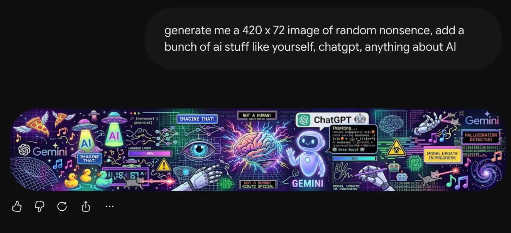

## **Disclosure**
The following write up includes topics about AI.  

Obviously, I use AI myself. I can confidently say that. But I don't use it to make full blown websites or use AI for every single stage of programming. Anywhere where I use AI, I disclose it in it's README or website footer.

## segment 0 - AI was first introduced
[When ChatGPT first released back in 2022](https://x.com/sama/status/1598038815599661056), it looked like this:  

My brother was the one to tell me about it. We tried it out together. One of our first prompts was to create a website.

It looked quite bland, pretty simple.  
Thought this AI thing was pretty interesting, as it couldn't do much that an actual human could do.  

At the time, I mainly discarded it, as I thought at the time that it would be some passion project by someone.

**I was wrong...**

## segment 1 - AI today
AI itself is now to a point, where [it uses up more traffic in the internet, THAN HUMAN BEINGS](https://radar.cloudflare.com/traffic#bot-vs-human).  

Most companies have already implemented AI features, just because of money. [Samsung](https://www.youtube.com/watch?v=UyyYbl0huC4), [Apple](https://www.youtube.com/watch?v=stWDBB_mohM), any company that involves with IT, are now involved with AI.

AI is even being used in audio, video and image generation. As a matter of fact, the thumbnail for this blog, was also made with AI.

The reasoning why I did that, as it better explains itself better than anything else. Only AI can make those weird, obviously looking, pictures. I can't, as I am a human.

There are more AI search results than actual search results, there might be even more AI created websites, than human created websites. 
It has **SINGLE HANDLINGLY** made all artists hate it, because it can draw.

## segment 2 - Programming and Programmers are dead
AI has ruined new generation programmers from learning and knowing what everything does. 

If you ask a person, that only has learned programming from using AI, if they know what a [CSRF](https://www.geeksforgeeks.org/computer-networks/what-is-cross-site-request-forgery-csrf/) is or whats the difference between [Server and Serverless](https://www.geeksforgeeks.org/system-design/server-vs-serverless-architecture/) without using their Phone or PC to ask ChatJipity.

During school, I had to do a 1 month internship. After it, we had to create a "Internship Defense" presentation.  
All it was, was a simple presentation, explaining what you did and if it applied to my profession.  

Obviously, before we had to do this presentation, our teacher looked over our presentations for any spelling mistakes, issues and to give an overall review of it.  

One of our classmates wrote that he used [Electron](https://www.electronjs.org/). He couldn't explain *what it was* and *how it was used in the project.*
He also couldn't answer what [Vue](https://vuejs.org/) did. He said that he mainly did the backend for the code. In the presentation, *he had listed that he used [React](https://react.dev/).*  

This just proves, that people are using AI, not even checking what it does, doesn't even PEEK what it made and just sends it.

## segment 3 - AI isn't all bad and evil
Yeah, true. There are some good applications to this, where you can learn a new topic or subject about a matter, which you don't even know.
Obviously, **make SURE it checks what sources it goes to and if they are valid.**

But the applications for thing that steal jobs? Nuh uh.

It has been causing massive layoffs in big companies. Companies, which aren't even massive in the tech world.
Some examples would be translators, historians, mathematicians, journalists, sales reps, writers [and more](https://news.sky.com/story/the-40-jobs-most-at-risk-of-ai-and-40-it-cant-touch-13447013)!

Stuff, that requires the usage of fixing something or something phyical, AI won't be able to touch in the next few years.
So people like caretakers, operators, builders cannot be taken as easily as possible.

## summary
Obviously, this AI craze wont stop, even if people imagine there will be some sort of [bubble that will pop](https://en.wikipedia.org/wiki/AI_bubble).  

People trying to define that [Chinas Market Value drop](https://futurism.com/artificial-intelligence/ai-bubble-burst-china) and [USAs Stock Market drop](https://economictimes.indiatimes.com/news/international/us/why-is-the-us-stock-market-down-today-dow-jones-sp-500-and-nasdaq-crash-big-as-strong-jobs-report-rising-treasury-yields-and-ai-stock-selloff-shake-wall-street-here-are-todays-biggest-gainers-and-losers/articleshow/131537800.cms) are "the start of the AI bubble to be popped", but what changes?

RAM, GPUs, Storage might decrease, but does that change the fact that people still use AI?

AI will still exist, as all the trained models will still exist in one way or another.  

Closed source models eventually will become open source at some point, probably from some data leak or them shutting down their company and *(not a chance)* doing the right thing and open sourcing them, instead of making them lost to time.